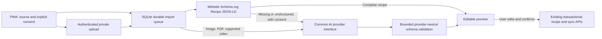

# AI Recipe Import

For a new server, complete [Installation](Installation) and [First-run setup](First-Run-Setup)
first. See [Configuration](Configuration) for container settings and
[Troubleshooting](Troubleshooting) for deployment/login problems.

MealF imports recipes from photographs, screenshots, PDFs, public recipe pages, supplied
text, and supported cooking videos. Cloud vision performs OCR and recipe understanding;
no OCR daemon, separate worker service, GPU, or additional Docker container is needed.

Every import is a draft. Review the title, servings, ingredients, quantities, units,
preparation/cooking/total times, and ordered instructions before saving. Missing facts
remain unknown, and extraction issues appear in the editor. AI output is not a food
safety, allergen, nutrition, or dietary certification.

## Architecture



The FastAPI modular monolith remains a single process with one SQLite writer. The existing
durable queue performs extraction independently of an open browser. Requests retain replay
fingerprints, cancellation/confirmation guards, and restore-aware sync checkpoints.
The PWA can queue a source offline in IndexedDB; after reconnection it uploads the source
before submitting the import. Closing the browser after submission does not cancel the job.

For websites, complete Schema.org Recipe JSON-LD takes precedence even when AI is enabled
for that import. No provider request or AI quota is consumed in that case. If metadata is
missing/incomplete, AI is used only when enabled and explicitly consented to. A failed or
private source is not silently replaced with fabricated content or fetched through an
authenticated scraping service.

The uploaded MealF schema bundle is preserved under `contracts/recipe-import/` as reference
schemas and examples. `recipe_extraction.py` implements its `schemaVersion: "1.0.0"`
extraction envelope with additional resource bounds and range validation. Unknown values
are `null`, not guessed defaults; original ingredient and quantity text remain available.
All provider adapters return `ExtractionResult`, independently of their native wire format.
The backend validates the result even when a provider offers structured output.

The existing canonical recipe/sync shape is extended additively: `times`, `language`,
`yield_info`, `category`, `cuisine`, `tags`, ingredient annotations, `instruction_details`,
and `schema_version`. Existing ingredient UUIDs and recipe mutation/ownership rules remain
server/client responsibilities, never model output. The full extraction stays with the
import draft; provider/model audit records are separate from recipe content. Incomplete
extractions open an editor with blank missing fields. They cannot be confirmed until the
required recipe facts are entered. Existing non-AI website imports retain their explicit
serving-default review warning for compatibility.

## Configure a provider

Sign in to the PWA, open **Settings → AI recipe import**, and enable extraction. The
administration console at `/` also provides the configuration under **Optional AI extraction**.
MealF currently uses its existing shared household account for administration; it does
not introduce a new role or a public registration mechanism.

1. Select a provider. **Google Gemini** is the initial provider option. AI stays disabled
   until configured; there is no bundled credential or hardcoded model version.
2. Enter the API base URL, exact model identifier from that provider, and API key.
3. Enable only input formats supported by that particular model and account. Text is
   always enabled. A provider's capabilities do not imply every model supports every format.
4. Set the hourly request limit and timeout. Enable structured JSON output only if the
   selected model/API supports it.
5. Choose **Save as default**. This selects the default provider/model for new imports.

Provider profiles, including model, capabilities and credential, are retained independently.
Switch back to a saved provider to reuse its profile. A blank key retains the saved key
only for the same provider and endpoint. Changing the endpoint clears the old key unless
you supply another; **Remove this provider’s saved key** explicitly clears it. Disabling
AI retains profiles while stopping extraction. Stored keys are never displayed or returned.

The console's **Test saved AI configuration** action sends a small synthetic text recipe.
It consumes quota and may incur charges. A successful text probe does not verify vision,
PDFs, video, or every model capability. The import preview is the relevant functional check
for a particular source format.

### Can I use my ChatGPT or Gemini subscription?

MealF's implemented cloud adapters authenticate with API keys. Signing into the ChatGPT
or Gemini consumer app does not configure an API key or enable MealF extraction.

- **OpenAI:** API billing is separate from ChatGPT subscriptions. OpenAI also supports
  subscription allowance sharing in eligible participating apps through Sign in with
  ChatGPT; the optional [personal ChatGPT text-import connection](../CHATGPT.md) implements
  that separate flow with a desktop helper and session-owned authorization. Do not use browser cookies,
  consumer account passwords or tokens copied from another tool as an API credential.
- **Gemini:** create a Gemini API project/key in Google AI Studio. Its free tier supports
  certain models within account/model quotas; paid usage uses the project's separate Cloud
  Billing configuration. A consumer subscription is not itself the API credential. Any
  subscription credit benefit depends on Google's current eligibility and supported services.

For a first test, create a free-tier Gemini API key if available for your account/region,
select an available model with the required input formats, enter the key in MealF settings,
save, and run the saved-configuration test in the console. Then import one non-sensitive
sample recipe and review it before Save. Local English/German photo OCR remains available
without a cloud account. Never paste the key into support chats or issues.

Checked 2026-10-22 against the providers' official documentation:
[OpenAI API billing](https://help.openai.com/en/articles/9039756-managing-billing-settings-on-chatgpt-web-and-platform),
[ChatGPT in participating apps](https://help.openai.com/en/articles/20001542-using-your-chatgpt-plan-in-other-apps-and-sites),
[Gemini API billing and free tier](https://ai.google.dev/gemini-api/docs/billing), and
[Gemini API keys](https://ai.google.dev/gemini-api/docs/api-key).

### Google Gemini

| Setting | Value |
| --- | --- |
| Provider | `gemini` |
| API base URL | `https://generativelanguage.googleapis.com/v1beta` |
| Model | Exact current model ID from Google AI Studio; enter it in settings |
| Available adapter formats | Text, image, PDF, video upload, public YouTube URL |

Create a Google AI Studio project and generate an API key at
[Google AI Studio](https://aistudio.google.com/apikey). Review the project's billing,
quota, region and data-use terms. Restrict the key to the required API where supported,
then enter it in MealF settings. Do not paste keys into recipe text or browser source code.

The adapter uses `generateContent` with native inline media, a separate system instruction,
JSON output, and optional `responseJsonSchema`. A model must support the formats you enable.
For video, MealF requests only the first ten minutes, sampled at one frame per second.
This is a bounded import, not a full-length transcription service.

### OpenAI

| Setting | Value |
| --- | --- |
| Provider | `openai` |
| API base URL | `https://api.openai.com/v1` |
| Model | Configurable model ID with the required vision/document capabilities |
| Available adapter formats | Text, image, PDF on models supporting native file input |

Create a project key in the [OpenAI API platform](https://platform.openai.com/api-keys).
Configure project permissions and billing limits, then enter the key in MealF. A ChatGPT
subscription is not an API credential or API billing plan.

The adapter uses Chat Completions: images are `image_url` data URLs; PDFs are native `file`
content parts. Enable PDF only when the selected model and endpoint document that contract.
The adapter bounds completion tokens and validates JSON locally. Native video parts and
YouTube URLs are not sent to this adapter; use supported images or supply a transcript.

### OpenRouter

| Setting | Value |
| --- | --- |
| Provider | `openrouter` |
| API base URL | `https://openrouter.ai/api/v1` |
| Model | Exact model slug, including its organization prefix |
| Available adapter formats | Text, image, PDF when supported by the selected route |

Create a key at [OpenRouter API keys](https://openrouter.ai/settings/keys). Fund/configure
the account and key spending limits. Review the selected upstream provider's privacy and
format support as well as OpenRouter's. Enter the key and model slug in MealF settings.

The adapter uses OpenAI-compatible content parts. PDF support depends on the route's native
file handling; MealF does not silently enable paid parsing plugins or switch upstream
models to overcome incompatibility. Configure a compatible route or provide images/text.

### Custom OpenAI-compatible APIs

Select `openai-compatible`, enter the complete API base URL (usually ending in `/v1`), and
obtain a credential from that service's administrator. MealF appends `/chat/completions`.
Supply the exact served model identifier; newer model names require no application update.

Use HTTPS with a certificate trusted by the container. The existing **Allow HTTP for a
trusted self-hosted endpoint** option is an explicit administrator opt-in for an internal
service; it is not a certificate-verification bypass. Configure private DNS/routing and
an appropriate trust chain in the deployment. Do not send a cloud key to an unrelated
custom endpoint. Legacy Anthropic/Ollama/OpenWebUI text configurations remain supported;
this feature does not enable native media for those legacy adapters.

### Docker and environment configuration

The existing Dockerfile builds the PWA and packages the Python modules and SQL migration.
Rebuild and restart the existing service, preserving the `/data` volume:

```sh
docker compose up --build -d
```

The existing **Photo or screenshot** camera/chooser remains a local English/German OCR
path and sends only recognized text when optional AI is selected. The attachment field
under **Link or text** is the separate path that sends a file to the configured AI model,
after explicit consent and capability checks. Both paths require review before saving.

No additional dependency or service is required. Migration `011_recipe_import.sql` creates
the private upload and AI-attempt tables and adds extraction data to import drafts. Released
migrations are unchanged. Standard household JSON/ZIP exports contain reviewed recipes and
their new metadata; they exclude provider credentials and transient source uploads.

Saved application settings take precedence over environment settings. For a deployment
managed with environment variables, the existing supported alternative is:

```yaml
environment:
  AI_PROVIDER: gemini
  AI_MODEL: ${MEALF_AI_MODEL}
  AI_INPUT_FORMATS: text,image,pdf
  AI_API_KEY_FILE: /run/secrets/recipe_ai_key
  AI_TIMEOUT: "30"
  AI_REQUESTS_PER_HOUR: "20"
```

This is a configuration fragment, not a complete Compose deployment. Mount the key file
through your secret mechanism, readable by the application's non-root account with no
group/other permissions (`0400` or `0600`). Never commit its contents. `AI_BASE_URL` overrides
the provider default; `AI_MAX_CONTENT` and `AI_STRUCTURED_OUTPUT=1` are also supported.

## Import and review

Open **Recipes → Import recipe**. Choose a supported file, paste a public URL, or supply
recipe text. Uploaded media requires AI and an explicit disclosure checkbox. Website
imports can use metadata without AI. Review the provider/model shown before consenting.
If settings change while a queued AI import is waiting, extraction stops for renewed review
rather than silently disclosing content to a different destination or model.

The preview is editable using the existing recipe editor, including ingredient ranges,
units, preparation, servings, timings and instructions. Warnings remain visible. Saving
uses the existing durable mutation/confirmation flow; duplicate submissions do not create
another recipe. Incomplete previews need a title, named ingredients, servings and steps
before confirmation. Cancelled or confirmed drafts cannot be resurrected by a late worker.

### Input formats and limits

| Input | Support and limits |
| --- | --- |
| Photographs/screenshots | JPEG, PNG, WebP; single frame, at most 8 MiB and 16 million decoded pixels. EXIF/GPS/text metadata is removed; images are normalized to JPEG, maximum 2048px edge and 1 MiB. Use legible scans. HEIC, SVG, animated GIF/WebP are rejected. |
| PDF | At most 8 MiB; checked for PDF signature/termination and sent natively to an enabled document-capable model. No local PDF rendering or script execution. Encrypted, corrupted, unusually long or unsupported PDFs can be rejected by the provider. |
| Website | Public HTTPS HTML or JSON-LD only; at most 1,000,000 bytes, bounded redirects/fetch time, validated public DNS addresses and pinned connections. Metadata first; AI fallback requires consent. |
| Video upload | MP4 or WebM with a matching container signature, at most 8 MiB, Gemini with `video` enabled. The cloud provider must support its codec. First ten minutes only. |
| Video URL | Public `youtube.com` / `youtu.be` watch, short or embed URL with a valid video ID; Gemini with `youtube` enabled. First ten minutes only. No playlist ingestion or arbitrary provider-side URL fetching. |
| Other social video | Public structured recipe metadata when available. Otherwise supply permitted recipe text, screenshots, or a supported video file. No private/authenticated scraping, DRM bypass, download service, or automatic social-media transcription. |
| Text | At most 100,000 characters accepted; the selected AI configuration's UTF-8 byte limit defaults to 50,000. No silent truncation. |

AI requests default to **20 per household per hour** (including probes), with a separately
limited probe action. Imports are capped at 20/hour and uploads at 40/hour. Provider
requests have a configurable 1–120 second timeout, an 8192-token output ceiling, and a
500,000-byte response ceiling. There is no automatic provider fallback that could duplicate
charges or change the disclosure destination. App limits complement, rather than replace,
provider billing/spending limits.

Transient uploaded sources have a combined 128 MiB storage budget. Hourly maintenance
removes sources older than seven days unless a queued import still needs them. Re-upload
an expired source to retry. Local queued bytes remain on the device until accepted by the
server; browser recovery exports include them as base64 media. Terminal extraction previews
are pruned after 30 days; minimal replay receipts remain. Provider/model/error-code attempt
metadata is retained for 90 days. Backups of the whole data volume may retain older data.

## Add a model or provider

### New model

Enter its exact identifier in settings, select the supported input formats, and save as
default. No source change or model-version update is required. Test the actual formats
you intend to use, and configure billing limits with the provider. Structured JSON support
is a model/endpoint capability; leave its checkbox off when uncertain.

### New provider adapter

The common interface in `src/aircooker/ai.py` is:

```python
class AIProvider(Protocol):
    def extract(self, source: AIInput) -> ExtractionResult: ...
    def close(self) -> None: ...
```

`BaseProvider.extract` checks configured capabilities/limits and validates the extraction
envelope. Implement the provider's wire mapping by overriding `generate_input`:

```python
class ExampleProvider(BaseProvider):
    def generate_input(self, source: AIInput, schema: dict) -> str:
        system, user = self.prompt(source, schema)
        # Map supported media explicitly; reject unimplemented formats.
        if source.kind != "text":
            raise DomainError("ai_input_format_unsupported", 422)
        response = self.send(
            "/generate",
            {"model": self.config.model, "system": system, "input": user,
             "max_output_tokens": 8192},
            {"Authorization": "Bearer " + self.config.api_key},
        )
        if response.get("complete") is not True:
            raise DomainError("ai_output_incomplete", 422)
        return response["text"]
```

Register the provider in `provider_for`, `PROVIDER_ENDPOINTS`, and `PROVIDER_FORMATS`; extend
the settings provider enum and UI label/options. Keep existing adapters unchanged. Use
`httpx.MockTransport` to verify request encoding, configurable model selection, capabilities,
authentication, truncation, quota responses and invalid JSON. Never trust a provider's claim
of schema compliance, include keys in prompt content, or accept model-supplied record IDs.

The legacy `extract_recipe(text)` method remains for existing text integrations/probes;
new imports use `extract(AIInput)` and the neutral extraction schema.

## Troubleshooting and security

| Symptom/code | Action |
| --- | --- |
| AI unavailable / `ai_not_configured` | Enable a provider, specify a model and save. Check that environment variables are not being overridden by a saved disabled setting. |
| `ai_input_format_unsupported` | Enable the format only if this model documents support, or choose a compatible model/provider and consent again. |
| `ai_authentication_failed` | Check the saved key, project permissions, endpoint and billing. A changed destination does not inherit another service's credential. |
| `ai_rate_limited`, `ai_request_limit`, `import_rate_limited` | Wait for the provider/application window to reset; check billing and configured quotas. |
| `ai_timeout`, `ai_provider_failed`, `ai_invalid_response` | Check the endpoint/network and service status. Increase the timeout within limits if appropriate. Provider response bodies are deliberately not echoed. |
| `ai_output_incomplete`, `ai_schema_validation_failed` | The model truncated/refused or returned invalid JSON. Try a clearer/smaller source or a compatible model, or enter the recipe manually. |
| `ai_configuration_changed_review_consent` | Review the newly selected provider/model and resubmit with renewed consent. |
| `import_source_expired` | Re-upload the source. |
| Source address/URL forbidden | Only permitted public HTTPS content is fetched. Do not disable SSRF or TLS checks; use permitted supplied text/media instead. |
| PDF/video rejected | Check its real format, encryption/codec, size and selected model support. Renaming a file does not convert it. |
| Video recipe incomplete | Only the first ten minutes are analysed. Supply permitted text or short clips/screenshots containing the missing facts. |

The Fernet integration vault encrypts provider profiles in `/data/config/ai-provider.enc`;
its key is in `/data/config/integrations.key`, with private file permissions. Protect the
data volume and its backups together: encryption does not protect against an attacker who
can read both files. Keep keys server-side, rotate compromised keys with the provider, and
use provider-side spending limits. No keys enter IndexedDB, recovery exports, canonical
recipes, application responses, or application logs.

Uploads and extraction drafts require household authentication; browser mutations also
use the existing CSRF checks. PDFs/videos have no public download route. Imported text
and media are untrusted data: adapters do not enable tools or execute instructions found
in a source. URL fetches retain private-address/redirect/TLS protections. Custom API
destinations are trusted administrator configuration, not URLs selected by recipe content.

Cloud providers receive the source you explicitly consent to send; their retention and
training policies still apply. Obtain rights to import supplied text/media, avoid private
screenshots, and review the chosen provider's terms before use.

## Validation status

Automated tests use synthetic recipe sources, mocked provider HTTP transports, and real
local browser/API flows. They can verify encoding, validation, provider selection and
review behavior without spending provider credits. Live provider/model/region compatibility
and physical Apple-device behavior require separate validation with an administrator's
configuration. This feature does not publish a Docker image or modify the independently
pinned native iOS contract; update that companion deliberately before native adoption.
